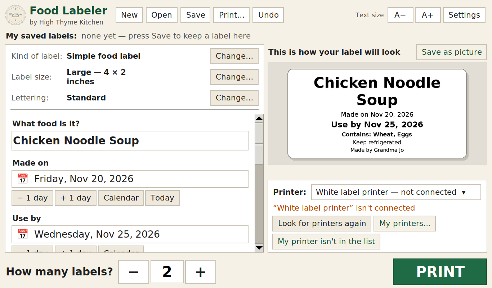
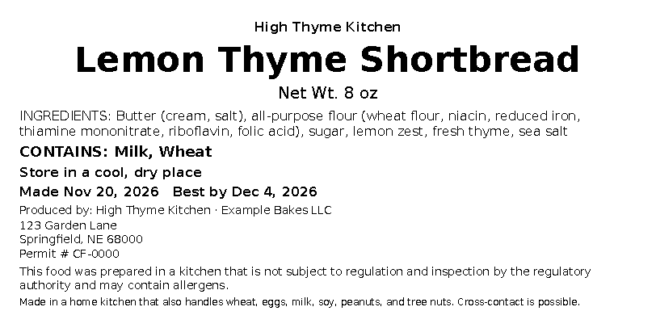
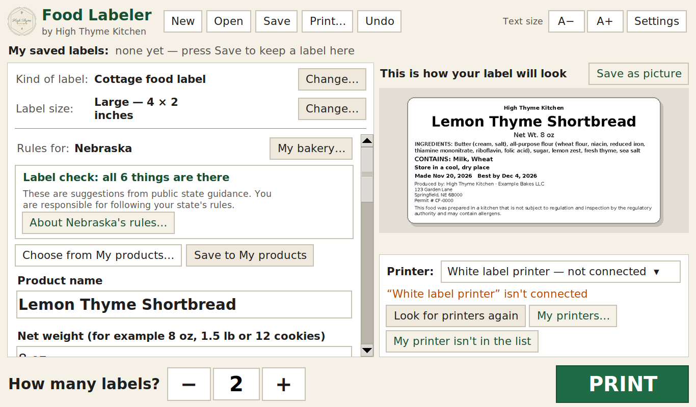
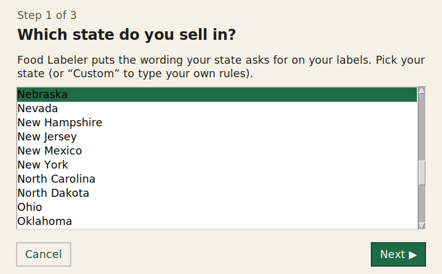
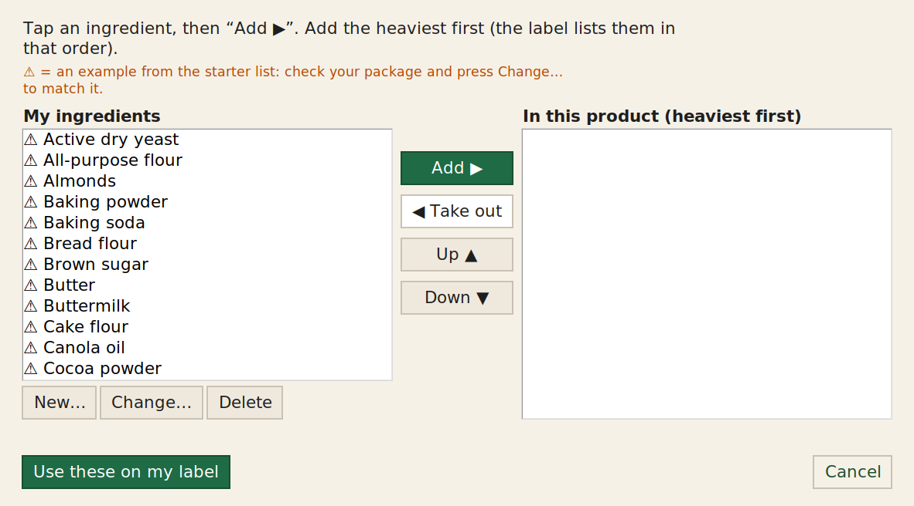
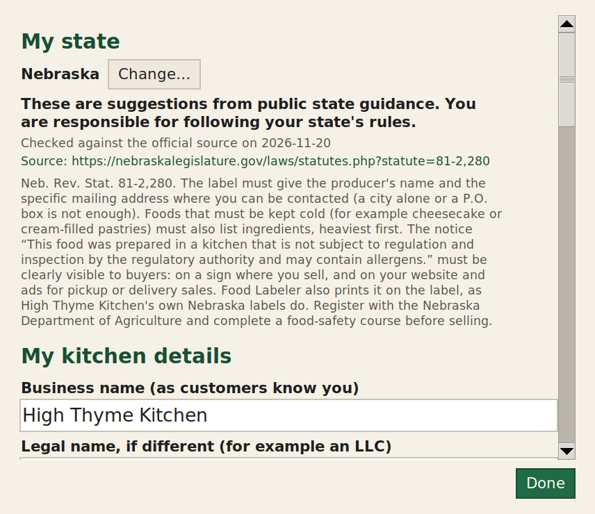

  

# Food Labeler

*by High Thyme Kitchen*

> ### In short
>
> **It's a free program that prints the sticker that goes on your food.**
>
> You bake cookies (or make soup, jam, bread…). You want a neat little
> sticker on the bag that says what it is, when you made it, and what's in
> it. If you sell what you bake from home, your state also wants certain
> words on that sticker.
>
> 1. Plug a small sticker printer into your computer.
> 2. Open Food Labeler and type the name of your food.
> 3. Press the big green **PRINT** button. Out comes your sticker.
>
> That's it. No account, no internet needed, nothing to pay.
> **[Download it here](../../releases/latest)** (Windows: `FoodLabeler.exe`).

<b>Type on the left &nbsp;→&nbsp; see your sticker on the right &nbsp;→&nbsp; press PRINT</b>

And this is the sticker that comes out: 

---

## More detail

Food Labeler makes clear, big-print labels for home-made food and prints
them on a small thermal label printer. Type what the food is, pick the dates,
tap any allergens, and press the big green **PRINT** button. What you see on
the screen is exactly what comes out of the printer. It works with
LP610BT-type label printers (sold as Labelnize, Flexyva, Polono and others)
and Zebra printers such as the ZP450, on Windows and Linux.

---

## Download

Get the newest version from the **[Releases page](../../releases/latest)**:

- **Windows:** `FoodLabeler.exe`
- **Linux:** `food-labeler`

`SHA256SUMS.txt` on the same page lets a helper check the download is intact.

---

## First time on Windows

1. **Install the printer's own driver first.** Use the driver from the company
   that made your printer (for LP610BT-type printers: the Labelnize, Polono or
   Flexyva driver; for Zebra: the ZDesigner driver). Plug the printer in with
   its USB cable and switch it on. It should now appear in Windows
   *Settings → Printers*.
2. **Download `FoodLabeler.exe`** from the [Releases page](../../releases/latest).
3. **Move it to your Desktop** (drag it from your *Downloads* folder), so it is
   easy to find next time.
4. **Double-click it.**
5. **Windows may show a blue box saying "Windows protected your PC".**
   That is normal for a small program that isn't sold in a shop: Windows has
   simply not seen it many times before. It does not mean anything is wrong.
   - Click the words **More info**.
   - Then click the **Run anyway** button that appears.

   Windows usually asks this only the first time you open a new download.
6. Food Labeler opens. If it finds your printer, its name is shown above the
   **PRINT** button. If not, see *The printer* below.

---

## How to use it

1. **Type what the food is** in the big box on the left, for example
   *Chicken Soup*.
2. **Made on** is already today.
3. **Use by**: press one of the quick buttons — *+3 days*, *+5 days*,
   *+1 week*, *+2 weeks*, *+1 month* — or press the date to pick it on a
   calendar.
4. **Contains**: tap any allergens that are in the food (Milk, Eggs, Wheat…).
5. If you like, add a **note** (tap *Keep refrigerated*, *Keep frozen*…) and
   **Made by**.
6. **Look at the picture on the right.** That is exactly what will print.
7. Choose **how many labels** with the big **−** and **+** buttons.
8. Press **PRINT**.

### Other things you can do

- **Kind of label → Change…**: *Simple food label*, *Package label* (with
  ingredients and your kitchen's name and address), *Date sticker*,
  *Free text*, or *Cottage food label* (for home bakers, see below).
- **Label size → Change…**: pick the size of the labels in your printer.
- **Save** keeps the label so you can print it again. Saved labels appear
  under **My saved labels** at the top — one click opens them. When you open
  an old label, Food Labeler asks if the dates should change to today.
- **Undo** takes back the last change.
- **A−** and **A+** make all the writing on the screen smaller or bigger.
- **Save as picture** makes a picture of the label to send to someone.
- If the writing doesn't fit, a message tells you which part is too long.
  Use shorter words or a bigger label.
- Your work is kept safe automatically, even if the computer switches off.

#### Fonts

- **Lettering → Change…** (under *Label size*) lets you pick the kind of
  letters on your label: one for the **name of the food** and one for
  **everything else**. Each choice is shown in its own lettering, so you can
  see what you get. Food Labeler remembers your choice for your next label.
- For the name you can pick fancy lettering such as *Pacifico* or *Caveat*.
  Everything else uses only clear, easy-to-read lettering, and the wording
  the law asks for (ingredients, allergens, your address, your state's
  wording) always stays easy to read.
- **Get more fonts…** (in the list of lettering) can fetch any font from
  [fonts.google.com](https://fonts.google.com): type its name, for example
  *Dancing Script*, look at it, and press **Add this font**. This is the only
  part of Food Labeler that uses the internet, and you never need it.
  **Add a font file from my computer…** adds a font you already have.
- If you open a label made on another computer with a font you don't have,
  Food Labeler shows it in the standard lettering and offers to get the font.

Details for helpers: [docs/fonts.md](docs/fonts.md).

### For home bakers (cottage food labels)

If you bake at home and sell under your state's *cottage food* law, choose
**Kind of label → Cottage food label**.

This is what that label prints (4 × 2 inch):

1. **Set up my bakery** (Food Labeler offers this the first time):
   pick your state, then type your bakery's name, full address (street,
   city, state and ZIP), phone, email and permit number if you have one.
   You can change these any time in **Settings → My bakery**.

   
2. Fill in the label: product name, net weight (type *8 oz* or *1.5 lb*;
   grams are added when your state asks for them), ingredients, allergens,
   how to store it and the dates.
3. **Build from My ingredients…** lets you pick ingredients in order,
   heaviest first. Each one remembers what's in it ("Butter (cream, salt)")
   and its allergens, so **Contains** fills itself in. The starter list is
   only an example: check each ingredient against your own package and
   press **Change…** to match it.

   
4. **Save to My products** keeps the product so next time **Choose from
   My products…** fills the whole label in one click.
5. The **Label check** at the top of the form says in green when everything
   your state asks for is on the label, or lists in red what is missing.
   **About (your state)'s rules…** shows the full list and where the rules
   come from. If something is missing, **PRINT** asks before printing.

   
6. Your state's required wording is printed at the size your state asks
   for. If it doesn't all fit, Food Labeler says so and suggests a bigger
   label; it never makes the required wording smaller or leaves it out.

**Your own wording is kept.** In **Settings → My bakery** you can change
the wording and the list of what must be on the label. Your changes are
marked *edited by you* and have a **Reset to state default** button. New
versions of Food Labeler never overwrite them; if your state's suggestion
changes, Food Labeler asks once whether to keep yours or use the new one.

> These are suggestions from public state guidance. You are responsible for
> following your state's rules. Each state's source and the date it was
> checked are shown in **My bakery**. States marked *Unverified — check with
> your state* could not be confirmed from an official source.

Details for helpers: [docs/cottage-rules.md](docs/cottage-rules.md).

### The printer

- The printer you are using is shown above the **PRINT** button. If you have
  more than one, click it to choose.
- **My printers…** lets you give printers names like *White label printer*.
  **Which one is it?** prints a tiny label saying which printer it is.
- **Look for printers again** if you just plugged one in.

---

## Something not right?

**The labels come out as a black block, or blank.**
Go to **Settings → Advanced…**, tick **Invert colours**, and press **Save**.
Some printers use the opposite colours; this switch fixes that.

**The printing is too pale or too dark.**
**Settings → Advanced…** has a *Darkness* slider: move it towards *Darker*
or *Lighter* and press **Save**.

**My printer isn't found.**
1. Check the printer is switched on and its cable is plugged in.
2. Press **Look for printers again**.
3. Still nothing? Press **My printer isn't in the list**. Unplug the printer,
   wait a moment and plug it back in — it shows up marked
   *"This just appeared"*. Press **Use this as my printer**.
4. If that doesn't work, press **Send this to High Thyme Kitchen**. It makes a
   short report about the computer and printer (never what is on your labels)
   that you can e-mail to us at hello@highthymekitchen.com, and we will help.

**On Windows, nothing prints but there is no error.**
**Settings → Advanced…** → tick **Print through Windows driver** → **Save**.

**Something else went wrong.**
Food Labeler keeps a log for your helper: *Settings → Advanced… → Open log
folder*, file `food-labeler.log`.

---

## For helpers and developers

- **Linux:** download `food-labeler`, make it executable
  (`chmod +x food-labeler`) and run it, or build it yourself with
  `./build_linux.sh` and install a menu entry with
  `./packaging/install_linux.sh`. Printing straight to a USB printer needs the
  user in the `lp` group (`sudo usermod -aG lp $USER`, then log out and in);
  a raw CUPS queue also works.
- **Where things are kept:** saved labels in `Documents\My Food Labels`
  (Linux: `~/Documents/My Food Labels`); settings, autosave, log, printer
  updates, *My bakery*, *My ingredients*, *My products*, fonts you added and
  your own cottage wording in `%APPDATA%\FoodLabeler` (Linux:
  `~/.local/share/food-labeler`). Updates to Food Labeler never change them.
- **State cottage food rules** and how to update them:
  [docs/cottage-rules.md](docs/cottage-rules.md).
- **New printer models** can be added with a printer update file — see
  [docs/printer-definitions.md](docs/printer-definitions.md).
- **How it works:** [docs/ARCHITECTURE.md](docs/ARCHITECTURE.md).
- **Building, testing, contributing:** [CONTRIBUTING.md](CONTRIBUTING.md).
- **Changes:** [CHANGELOG.md](CHANGELOG.md).
- Sample printouts of every label kind and size: [docs/samples](docs/samples).
- Screenshots in `docs/` come from `python tools/screenshot.py docs` (it
  opens the real window with example data for about half a minute).

## License

Food Labeler is free and open source under the [MIT License](LICENSE).

Bundled fonts: DejaVu Sans (Bitstream Vera license, see
`food_labeler/fonts/LICENSE-DejaVu.txt`); Atkinson Hyperlegible, Roboto,
Open Sans, Lato, Playfair Display, Pacifico, Lobster and Caveat from Google
Fonts (SIL Open Font License 1.1, each with its `OFL.txt` in
`food_labeler/fonts/`; sources in [docs/fonts.md](docs/fonts.md)). The seal artwork in `assets/`
uses the Parisienne typeface (SIL Open Font License 1.1). The High Thyme
Kitchen name and seal are the kitchen's branding and are not covered by the
MIT License; if you publish your own version, please use your own name and
logo.
