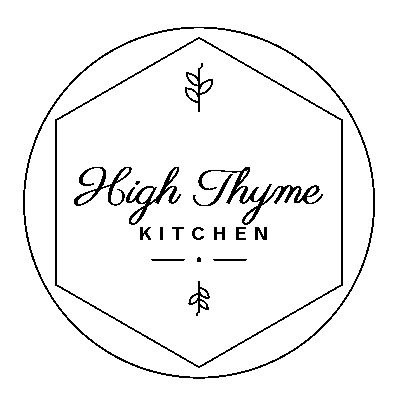
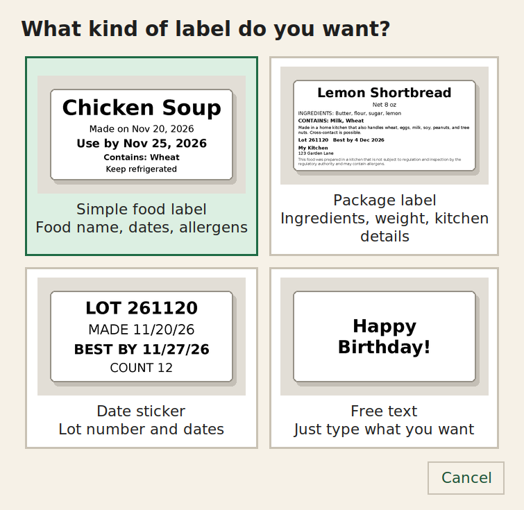

  

# Food Labeler

*by High Thyme Kitchen*

Food Labeler makes clear, big-print labels for home-made food and prints
them on a small thermal label printer. Type what the food is, pick the dates,
tap any allergens, and press the big green **PRINT** button. What you see on
the screen is exactly what comes out of the printer. It works with
LP610BT-type label printers (sold as Labelnize, Flexyva, Polono and others)
and Zebra printers such as the ZP450, on Windows and Linux.

---

## Download

Get the newest version from the **[Releases page](../../releases/latest)**:

- **Windows:** `FoodLabeler.exe`
- **Linux:** `food-labeler`

`SHA256SUMS.txt` on the same page lets a helper check the download is intact.

---

## First time on Windows

1. **Install the printer's own driver first.** Use the driver from the company
   that made your printer (for LP610BT-type printers: the Labelnize, Polono or
   Flexyva driver; for Zebra: the ZDesigner driver). Plug the printer in with
   its USB cable and switch it on. It should now appear in Windows
   *Settings → Printers*.
2. **Download `FoodLabeler.exe`** from the [Releases page](../../releases/latest).
3. **Move it to your Desktop** (drag it from your *Downloads* folder), so it is
   easy to find next time.
4. **Double-click it.**
5. **Windows may show a blue box saying "Windows protected your PC".**
   That is normal for a small program that isn't sold in a shop: Windows has
   simply not seen it many times before. It does not mean anything is wrong.
   - Click the words **More info**.
   - Then click the **Run anyway** button that appears.

   Windows usually asks this only the first time you open a new download.
6. Food Labeler opens. If it finds your printer, its name is shown above the
   **PRINT** button. If not, see *The printer* below.

---

## How to use it

1. **Type what the food is** in the big box on the left, for example
   *Chicken Soup*.
2. **Made on** is already today.
3. **Use by**: press one of the quick buttons — *+3 days*, *+5 days*,
   *+1 week*, *+2 weeks*, *+1 month* — or press the date to pick it on a
   calendar.
4. **Contains**: tap any allergens that are in the food (Milk, Eggs, Wheat…).
5. If you like, add a **note** (tap *Keep refrigerated*, *Keep frozen*…) and
   **Made by**.
6. **Look at the picture on the right.** That is exactly what will print.
7. Choose **how many labels** with the big **−** and **+** buttons.
8. Press **PRINT**.

### Other things you can do

- **Kind of label → Change…**: *Simple food label*, *Package label* (with
  ingredients and your kitchen's name and address), *Date sticker*, or
  *Free text*.
- **Label size → Change…**: pick the size of the labels in your printer.
- **Save** keeps the label so you can print it again. Saved labels appear
  under **My saved labels** at the top — one click opens them. When you open
  an old label, Food Labeler asks if the dates should change to today.
- **Undo** takes back the last change.
- **A−** and **A+** make all the writing on the screen smaller or bigger.
- **Save as picture** makes a picture of the label to send to someone.
- If the writing doesn't fit, a message tells you which part is too long.
  Use shorter words or a bigger label.
- Your work is kept safe automatically, even if the computer switches off.

### The printer

- The printer you are using is shown above the **PRINT** button. If you have
  more than one, click it to choose.
- **My printers…** lets you give printers names like *White label printer*.
  **Which one is it?** prints a tiny label saying which printer it is.
- **Look for printers again** if you just plugged one in.

---

## Something not right?

**The labels come out as a black block, or blank.**
Go to **Settings → Advanced…**, tick **Invert colours**, and press **Save**.
Some printers use the opposite colours; this switch fixes that.

**The printing is too pale or too dark.**
**Settings → Advanced…** has a *Darkness* slider: move it towards *Darker*
or *Lighter* and press **Save**.

**My printer isn't found.**
1. Check the printer is switched on and its cable is plugged in.
2. Press **Look for printers again**.
3. Still nothing? Press **My printer isn't in the list**. Unplug the printer,
   wait a moment and plug it back in — it shows up marked
   *"This just appeared"*. Press **Use this as my printer**.
4. If that doesn't work, press **Send this to High Thyme Kitchen**. It makes a
   short report about the computer and printer (never what is on your labels)
   that you can e-mail to us at hello@highthymekitchen.com, and we will help.

**On Windows, nothing prints but there is no error.**
**Settings → Advanced…** → tick **Print through Windows driver** → **Save**.

**Something else went wrong.**
Food Labeler keeps a log for your helper: *Settings → Advanced… → Open log
folder*, file `food-labeler.log`.

---

## For helpers and developers

- **Linux:** download `food-labeler`, make it executable
  (`chmod +x food-labeler`) and run it, or build it yourself with
  `./build_linux.sh` and install a menu entry with
  `./packaging/install_linux.sh`. Printing straight to a USB printer needs the
  user in the `lp` group (`sudo usermod -aG lp $USER`, then log out and in);
  a raw CUPS queue also works.
- **Where things are kept:** saved labels in `Documents\My Food Labels`
  (Linux: `~/Documents/My Food Labels`); settings, autosave, log and printer
  updates in `%APPDATA%\FoodLabeler` (Linux: `~/.local/share/food-labeler`).
- **New printer models** can be added with a printer update file — see
  [docs/printer-definitions.md](docs/printer-definitions.md).
- **How it works:** [docs/ARCHITECTURE.md](docs/ARCHITECTURE.md).
- **Building, testing, contributing:** [CONTRIBUTING.md](CONTRIBUTING.md).
- **Changes:** [CHANGELOG.md](CHANGELOG.md).
- Sample printouts of every label kind and size: [docs/samples](docs/samples).
- TODO: a fresh screenshot of the main window. (`docs/screenshot.png` is from
  an older test build and is not used here.)

## License

Food Labeler is free and open source under the [MIT License](LICENSE).

Bundled fonts: DejaVu Sans (Bitstream Vera license, see
`food_labeler/fonts/LICENSE-DejaVu.txt`). The seal artwork in `assets/`
uses the Parisienne typeface (SIL Open Font License 1.1). The High Thyme
Kitchen name and seal are the kitchen's branding and are not covered by the
MIT License; if you publish your own version, please use your own name and
logo.
