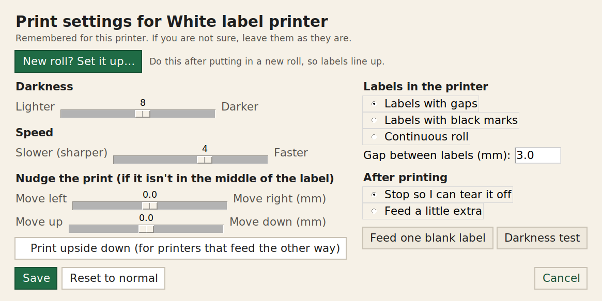
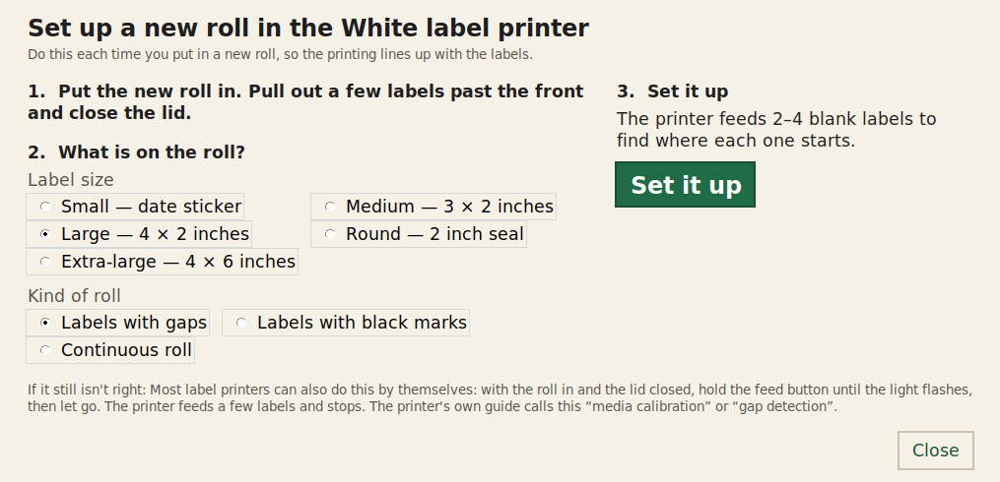

# Your printer

[← Back to the start](../README.md)

Food Labeler works with LP610BT-type label printers (sold as Labelnize,
Flexyva, Polono and others) and the Zebra ZP450, on Windows and Linux. These
two are **tested** on paper. Many other cheap label printers (MUNBYN, Rollo,
iDPRT, Phomemo, Jadens, Xprinter and more) should work too, but are
**alpha — not tested yet**: their name has *(alpha — not tested yet)* after
it, and the first time you print to one, Food Labeler says so once. See
[Printers we know about](printer-list.md), and please tell us how it goes.

Printers connect with a **USB** cable, or over **Bluetooth (alpha)**: see
[Bluetooth printers](#bluetooth-printers-alpha).

- [Picking your printer](#picking-your-printer)
- [Print settings](#print-settings)
- [Sharpness: 203 or 300 dpi](#sharpness-203-or-300-dpi)
- [New roll? Set it up](#new-roll-set-it-up)
- [Bluetooth printers (alpha)](#bluetooth-printers-alpha)
- [My printer isn't in the list](#my-printer-isnt-in-the-list)
- [Getting help](#getting-help)

If something prints wrong, see [Something not right?](troubleshooting.md).

## Picking your printer

- The printer you are using is shown above the **PRINT** button. If you have
  more than one, click it to choose.
- **My printers…** lets you give printers names like *White label printer*.
  **Which one is it?** prints a tiny label saying which printer it is.
- **Look for printers again** if you just plugged one in.

## Print settings

**Print settings…** (under the printer list) is kept for each printer:

- *Darkness*: lighter or darker.
- *Speed*: slower is sharper.
- *Nudge the print* if it isn't in the middle of the label.
- *Print upside down*.
- The kind of labels in the printer: with gaps, with black marks, or a
  continuous roll.
- Whether it stops so you can tear the label off.

**Darkness test** prints 3 labels (lighter, now, darker) so you can pick
the best; **Feed one blank label** moves the roll on. **Reset to normal**
puts everything back.

## Sharpness: 203 or 300 dpi

**Sharpness** (in **My printers…**): most label printers are *Normal
(203 dpi)*, and Food Labeler picks that for you. Only change it to
*Sharp (300 dpi)* if your printer (or its box) says 300 dpi. Your labels
stay the same size either way; at 300 dpi the writing is just crisper.

## New roll? Set it up

Each time you put a new roll in the printer, set it up once, so the
printing lands on the labels and not across the gaps between them.

1. Press **Print settings…** (under the printer list), then
   **New roll? Set it up…**.
2. **Put the new roll in.** Pull out a few labels past the front and close
   the lid.
3. **Say what is on the roll:** the label size (your label's size is already
   picked) and the kind of roll: *Labels with gaps* (most rolls), *Labels
   with black marks* (black lines on the back) or *Continuous roll* (one long
   strip, no gaps).
4. Press **Set it up**. Food Labeler asks first, because the printer feeds
   2–4 blank labels to measure them. A continuous roll needs no setting up;
   this only tells the printer the size, and no labels are used.
5. If you like, press **Print one test label**. It has a box just inside
   the edges and an arrow pointing to the end that comes out first. If the
   box sits on the label, press **Looks right**. If not, press **It's off —
   help me** for what to try.

The window also says how to set up a roll with the printer's own feed
button, in case that is ever needed. Food Labeler remembers which roll you
set up on each printer. When you pick a different label size, a short line
under the printer asks *"New roll in the … printer? Set it up"*; press
**Set up**, or **No, same roll** if you didn't change the roll. Nothing is
ever sent to the printer until you press **Set it up** and say OK.
(**Settings → Advanced… → Feed / calibrate…** opens the same window.)

## Bluetooth printers (alpha)

LP610BT-type printers with Bluetooth can print without the cable. This is
new and **hasn't been tested on paper yet**: a Bluetooth printer has
*(alpha — not tested yet)* after its name, even if the same printer is
tested over USB, and the first time you print to it over Bluetooth Food
Labeler says so once. If it doesn't work, use the USB cable, and please tell
us on GitHub.

Food Labeler never pairs with a printer by itself. You pair it once in the
computer's own Bluetooth settings:

**Windows**

1. Switch the printer on, close to the computer.
2. Open **Settings → Bluetooth & devices → Add device → Bluetooth**, and
   pick the printer (LP610BT-type printers are called *LP610BT*). If it asks
   for a PIN, try **0000** or **1234**.
3. In Food Labeler, press **Look for printers again**. The printer shows up
   as, for example, *… — Bluetooth COM5 (…3F:A2)*.

If you installed the printer maker's driver on the Bluetooth port, the
printer is an ordinary Windows printer and works the same way as over USB.

**Linux**

1. Switch the printer on, close to the computer.
2. Pair it in your desktop's **Bluetooth** settings (or ask your helper to
   use `bluetoothctl`: `pair`, then `trust`). If it asks for a PIN, try
   **0000** or **1234**.
3. In Food Labeler, press **Look for printers again**. The printer shows up
   as, for example, *… — Bluetooth (…3F:A2)*.

**Two printers with the same name?** Both of ours are called *LP610BT*.
The end of the Bluetooth address (*…3F:A2*) tells them apart. Open **My
printers…**, press **Which one is it?** next to one of them (it prints a
small label on that printer) and give it a name, such as *White label
printer*.

If printing says the printer isn't answering, check that it is switched on
and close by, and that it is still paired. If it says *Bluetooth is switched
off on this computer*, switch Bluetooth on in the computer's settings. A
helper can pick the Bluetooth channel in **Settings → Advanced…** (most
printers use channel 1, and Food Labeler tries 1, 2 and 3 by itself).

Mac computers aren't supported.

## My printer isn't in the list

1. Check the printer is switched on and its cable is plugged in.
2. Press **Look for printers again**.
3. Still nothing? Press **My printer isn't in the list**. Unplug the printer,
   wait a moment and plug it back in: it shows up marked
   *"This just appeared"*. Press **Use this as my printer**.
4. If that doesn't work, press **Ask for help on GitHub**. It makes a short
   report about the computer and printer (never what is on your labels),
   copies it, and opens the *My printer isn't working* form on GitHub. Paste
   the report into the box on the page (right-click → **Paste**), say what
   happened, and we'll try to help. It only lists the printers plugged in. If
   we ask you to, tick **Also list everything else plugged in** to add the
   other USB things (their names only, never their serial numbers).

A Bluetooth printer isn't in the USB list: press **How to connect a
Bluetooth printer** in the same window, or see
[Bluetooth printers](#bluetooth-printers-alpha). The report lists paired
Bluetooth printers with only the end of their address; other Bluetooth
things (phones, headphones) are only counted.

## Getting help

[Open an issue on GitHub](https://github.com/lilfade/food-labeler/issues/new/choose) and pick the kind of problem
(*My printer isn't working*, *Add my printer*, …). In Food Labeler,
**Settings → Get help with my printer…** makes the printer report and opens
the right form for you. It's free to make a GitHub account; or, if you're
stuck, use **Or email it instead** in the same window, or email
hello@highthymekitchen.com.
